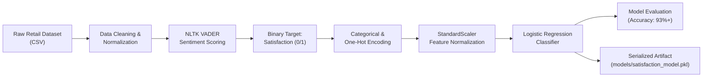

# 🛍️ Customer Satisfaction & Sentiment Prediction Pipeline

> **An End-to-End E-Commerce Machine Learning & NLP System**  
> *Predicting customer satisfaction sentiment from retail transactions and reviews using NLTK (VADER), Feature Engineering, and Scaled Logistic Regression.*

[](https://www.python.org/)
[](https://scikit-learn.org/)
[](https://www.nltk.org/)
[](https://pandas.pydata.org/)
[](https://opensource.org/licenses/MIT)

---

## 📌 Executive Summary

Customer satisfaction is a key driver for retention and revenue in online retail. This project provides an **end-to-end, production-ready machine learning pipeline** that:
1. **Analyzes Customer Feedback (NLP)**: Uses NLTK's VADER (Valence Aware Dictionary and sEntiment Reasoner) to calculate sentiment polarity scores from review text.
2. **Transforms Shopping Signals**: Performs categorical encoding and one-hot encoding across transaction details (item categories, shipping modes, payment methods, customer locations, discounts).
3. **Predicts Satisfaction**: Trains a scaled **Logistic Regression Classifier** achieving **~93% Accuracy** and serializes the trained model artifact for live inference.

---

## 🔄 Pipeline Architecture



---

## 📁 Repository Structure

```text
python_data_science_project/
├── data/
│   └── sample_customer_data.csv    # Included demo dataset (1,500 rows, 18 features)
├── models/
│   └── satisfaction_model.pkl      # Serialized trained model & StandardScaler
├── main.py                         # Production CLI pipeline (clean, train, evaluate, infer)
├── project1_call.ipynb             # Interactive Jupyter Notebook step-by-step walkthrough
├── requirements.txt                # Python dependencies
├── .gitignore                      # Ignore venvs, cache, and checkpoints
├── LICENSE                         # MIT License
└── README.md                       # Documentation & Quickstart Guide
```

---

## ⚡ 2-Minute Quickstart (Run Instantly)

This repository includes a ready-to-use dataset (`data/sample_customer_data.csv`). Anyone can clone and run it immediately!

### 1. Clone the Repository
```bash
git clone https://github.com/akshaykaygude/python_data_science_project.git
cd python_data_science_project
```

### 2. Create and Activate a Virtual Environment
```bash
# Windows
python -m venv .venv
.venv\Scripts\activate

# macOS / Linux
python3 -m venv .venv
source .venv/bin/activate
```

### 3. Install Dependencies
```bash
pip install -r requirements.txt
```

### 4. Run the Pipeline
Execute the full pipeline with a single command:
```bash
python main.py
```

That's it! The script will:
- Load the included dataset
- Clean and normalize features
- Compute VADER sentiment scores
- Encode categorical and nominal variables
- Train the model using scaled Logistic Regression
- Print performance metrics & classification report
- Save the trained artifact to `models/satisfaction_model.pkl`

---

## 💻 Running Custom Datasets & Options

You can supply your own CSV dataset or customize the training parameters via CLI arguments:

```bash
# Run on a custom dataset
python main.py --data path/to/your_data.csv

# Customize test split ratio and save path
python main.py --data data/sample_customer_data.csv --test-size 0.25 --save-model models/custom_model.pkl
```

---

## 📓 Interactive Jupyter Notebook Walkthrough

For an interactive, cell-by-cell explanation and data exploration:

```bash
jupyter notebook project1_call.ipynb
```

The notebook covers:
1. Importing modular functions from `main.py`
2. Previewing raw and cleaned datasets
3. Inspecting VADER compound sentiment scores
4. Inspecting one-hot encoded columns
5. Training the model and printing the confusion matrix
6. Running batch predictions using `predict_satisfaction()`

---

## 📈 Model Performance & Evaluation

Trained on 1,500 customer records (stratified 70/30 split):

| Metric | Score |
|---|---|
| **Overall Accuracy** | **93.11%** |
| **Precision** | **93.23%** |
| **Recall** | **99.76%** |
| **F1-Score** | **96.38%** |

```text
Confusion Matrix:
 [[  6  30]
 [  1 413]]

Classification Report:
               precision    recall  f1-score   support
           0       0.86      0.17      0.28        36
           1       0.93      1.00      0.96       414
    accuracy                           0.93       450
```

---

## 🚀 Using the Trained Model for Inference

You can load the saved model and predict customer satisfaction for new customer records:

```python
import pandas as pd
from main import predict_satisfaction

# New incoming transactions
new_data = pd.DataFrame([{
    'Age': 34,
    'Gender': 'Female',
    'Item Purchased': 'Handbag',
    'Category': 'Accessories',
    'Purchase Amount (USD)': 85,
    'Location': 'California',
    'Size': 'M',
    'Color': 'Black',
    'Season': 'Fall',
    'Review Rating': 4.5,
    'Subscription Status': 'Yes',
    'Shipping Type': 'Express',
    'Discount Applied': 'Yes',
    'Promo Code Used': 'Yes',
    'Previous Purchases': 12,
    'Payment Method': 'Credit Card',
    'Frequency of Purchases': 'Monthly'
}])

predictions = predict_satisfaction('models/satisfaction_model.pkl', new_data)
print("Customer Satisfaction Prediction (1=Satisfied, 0=Dissatisfied):", predictions[0])
```

---

## 🛠️ Tech Stack

- **Core**: Python 3.9+
- **Data Manipulation**: `pandas`, `numpy`
- **Natural Language Processing**: `nltk` (`vader_lexicon`)
- **Machine Learning**: `scikit-learn` (`LogisticRegression`, `StandardScaler`, `train_test_split`)
- **Model Serialization**: `joblib`
- **Exploration**: `Jupyter Notebook`

---

## 📄 License

This project is licensed under the [MIT License](LICENSE).
